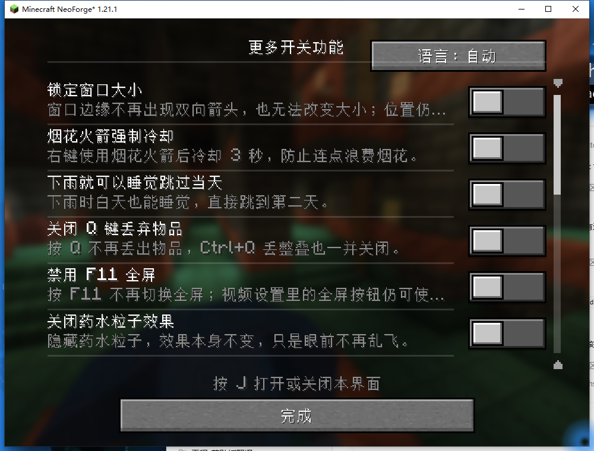
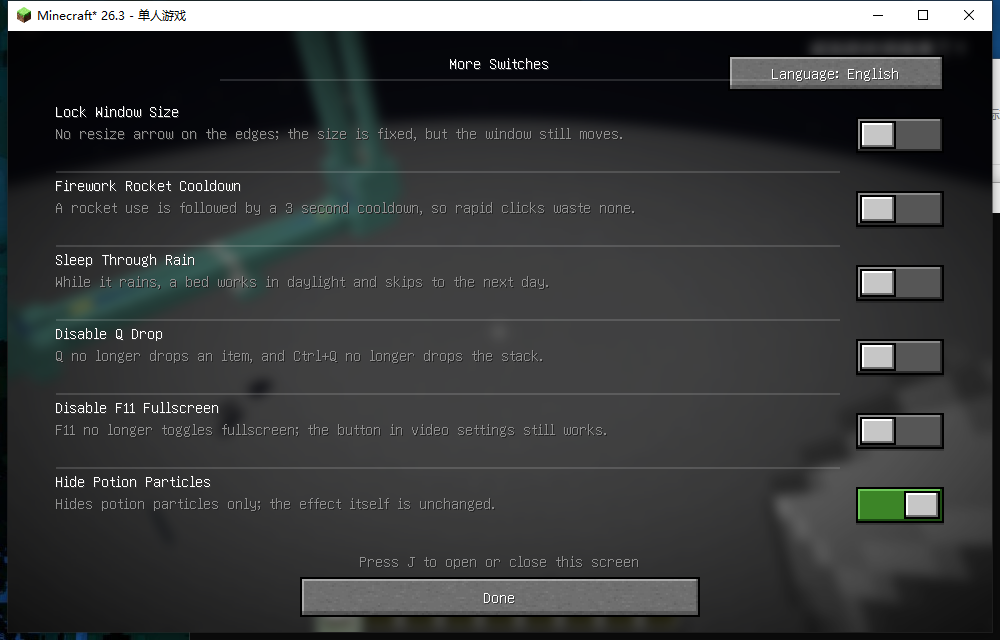

# 更多开关功能 (More Switches)

Minecraft 1.21.1 · NeoForge 21.1.256 · Java 21

作者: 黑山大叔 — https://space.bilibili.com/19428259
核心结构来自: https://crates.io/crates/lighty-launcher

一页开关式的实用工具模组。按 **J** 打开设置界面，一行一个功能，
右侧是左右拨动的开关（灰色=关，绿色=开）。

> 本版本已从 Fabric 26.3 迁移到 NeoForge 1.21.1，16 个开关全部完成。
> 迁移过程与 API 对照见 [docs/迁移说明-1.21.1-NeoForge.txt](docs/迁移说明-1.21.1-NeoForge.txt)。



| 行 | 功能 | 说明 |
|---|---|---|
| 1 | 锁定窗口大小 | 窗口边缘不再出现双向箭头、无法改变大小；位置仍可自由拖动 |
| 2 | 烟花火箭强制冷却 | 右键使用烟花火箭后强制冷却 3 秒，防止连点浪费烟花 |
| 3 | 下雨就可以睡觉跳过当天 | 下雨时白天也能睡觉，直接跳到第二天 |
| 4 | 关闭 Q 键丢弃物品 | 按 Q 不再丢出物品，Ctrl+Q 丢整叠也一并关闭 |
| 5 | 禁用 F11 全屏 | 按 F11 不再切换全屏；视频设置里的全屏按钮仍可用 |
| 6 | 关闭药水粒子效果 | 隐藏药水粒子，效果本身完全不变 |
| 7 | 预览光照范围 | 手持光源看向方块，用青色数字显示光照等级 |
| 8 | 移动光源 | 手持火把时周围有亮度渐变，纯视觉 |
| 9 | 关闭资源包警告 | 启用版本不匹配的资源包时不再弹确认框 |
| 10 | 关闭篝火烟雾 | 篝火不再冒烟，火焰与烹饪不受影响 |
| 11 | 关闭新手教程 | 不再弹出任何新手教程提示 |
| 12 | 生存使用假玩家 | 改 Carpet 的 commandPlayer，生存也能用 /player |
| 13 | 副手自动补充图腾 | 副手没图腾时自动从背包补上 |
| 14 | 关闭爆炸声 | 去掉爆炸轰鸣（爆炸共用一个音效） |
| 15 | 关闭矿车声音 | 去掉滚动噪音与乘坐闷响 |
| 16 | 关闭活塞声音 | 去掉活塞推出与收回的声音 |

功能超过可视范围时列表可滚动：滚轮、滚动条两端箭头、点击轨道都可以。

设置保存在 `config/moreswitches.json`，拨动开关立即写入。

界面标题右侧有语言按钮：自动 → 中文 → English → 自动。切换只影响本模组界面，
不会改动游戏语言。



## 安装

1. 安装 Minecraft 1.21.1 + NeoForge 21.1.256（Java 21）
2. 把 `moreswitches-2.0.0.jar` 放进 `.minecraft/mods/`
3. 进游戏按 **J** 打开界面

## 构建

需要 JDK 21 运行游戏、JDK 25 编译（用 `--release 21` 产出 Java 21 类）。
NeoForge 的 Maven 在部分网络下不可达，所以这里不依赖 Gradle 在线解析，
而是用本地缓存的依赖 + 反混淆后的游戏 jar 直接编译：

```bash
python tools/nf_module_jar.py   # 生成 minecraft 命名模块（只需一次）
python tools/nf_compile.py      # 编译主代码与测试
python tools/nf_test.py         # 运行单元测试，不需要启动游戏
python tools/nf_package.py      # 产出可安装 jar 到 _build/nf-dist/
python tools/package.py         # 打包交付 zip
```

`tools/build.cmd` 是受限沙箱里用的构建脚本，JDK 与 Gradle 位置从环境变量
（`JAVA_HOME`、`GRADLE_BIN`）读取；正常机器上用不到。

## 代码结构

```
src/main/java/com/heishandashu/moreswitches/     公共侧：配置、语言、入口、纯逻辑规则
src/client/java/com/heishandashu/moreswitches/   客户端：界面、按键、功能模块、mixin
src/main/resources/assets/moreswitches/lang/     中英文语言文件
src/test/java/                                   单元测试（纯逻辑，无需游戏）
docs/                                            使用说明 / 技术说明 / 踩坑总结 / 界面截图
tools/                                           备份、打包、图标、语言核对、启动脚本
```

一个贯穿全局的约定：每个开关的判定都抽成不依赖 Minecraft 类型的纯函数
（`CooldownClock`、`RainSleepRule`、`DropKeyRule`、`FullscreenKeyRule`、
`EffectParticleRule`），边界条件用 JUnit 在几秒内验证；mixin 只负责把判定接到游戏里，
不含业务逻辑。

## 实现说明与限制

- **锁定窗口大小**：只锁大小，不锁位置。用 `SDL_SetWindowResizable(false)` 去掉可调整
  边框，并额外触发一次 `SWP_FRAMECHANGED` 让 Windows 重算非客户区——只改样式的话，
  双箭头光标会残留。
- **下雨睡觉**：注入 `BedRule.canSleep`，只在原版判为 false 时改成 true。跳过时间交给
  原版自己的 `WAKE_UP_FROM_SLEEP` 时间标记，不另写一套时间推进。
- **烟花冷却 / Q 键 / F11 / 药水粒子**：纯客户端拦截，多人服务器里只作用于自己的客户端，
  不修改服务端行为。
- **关闭药水粒子**：只丢弃 `ENTITY_EFFECT` 与 `INSTANT_EFFECT` 两种粒子类型；火焰、烟、
  水花、爆炸、红石等不受影响。效果数据完全不动，药的强度与时长不变。
- **预览光照范围**：注入 `LevelRenderer.submitBlockOutline` 之后，用 `submitText` 在世界空间
  画青色数字。只标「模拟光比现有方块光更亮」且上方是空气的方块。
- **资源包警告**：注入 `PackCompatibility.isCompatible` 返回 true，跳过确认框；包照常加载。
- **篝火烟雾**：取消 `CampfireBlock.makeParticles`（三种篝火的共同产烟入口），火焰保留。
- **新手教程**：取消 `Tutorial.start()`。它的 tick/onMouse/onInput 等回调都会判空，
  所以阻止启动不会引发空指针，且一整套提示都不会出现。
- **移动光源**：注入 `LightCoordsUtil.getLightCoords`，用 `withBlock` 只替换方块光位、
  保留天空光位。取 `max` 而非相加——原版光不叠加。
  注意：光照贴图是（方块光，天空光）的二维查找表、不含位置，改它会让全屏变亮，
  所以局部光只能在「每个方块位置」这一层做。
- `moreswitches.client.mixins.json` 与 `moreswitches.mixins.json` 中的注入点都带
  `require = 1`：若将来版本改了目标方法名，游戏会在启动时直接报错，而不是让开关静默失效。

## 已知未验证项

- 烟花冷却、Q 键、F11、药水粒子这四项的**判定逻辑与注入点**已验证（单元测试 +
  Mixin 导出字节码确认 + 进程内实测门控行为），但未用真人按键/喝药水跑完整流程。
- 多显示器 DPI 变化时的窗口锁定行为未验证。

## 许可

MIT，见 [LICENSE](LICENSE)。

作者主页: <https://space.bilibili.com/19428259>  
核心结构参考: <https://crates.io/crates/lighty-launcher>
